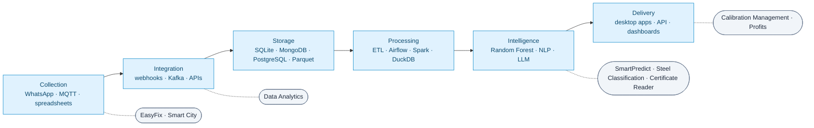
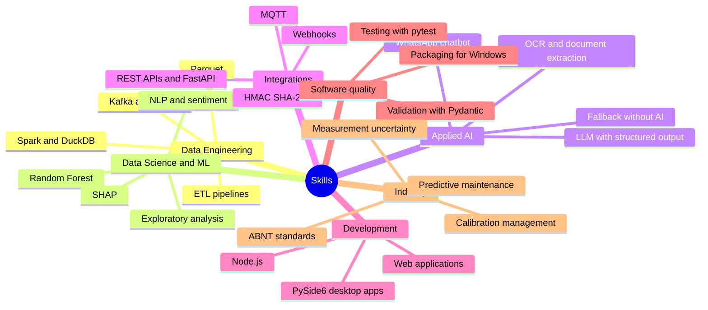

  <b>🌐 Choose your language · Escolha o idioma</b>  
  
  

---

# Control and Automation Engineering | Data Science and Artificial Intelligence

  
  

  
  
  
  

  Portfolio of solutions that go from raw data to decisions: <b>data pipelines</b>, <b>Machine Learning</b>,
  <b>AI-powered customer service automation</b> and <b>industrial applications</b>, including systems in
  real use in an industrial environment.

  <a href="#-in-numbers">In numbers</a> •
  <a href="#-overview">Overview</a> •
  <a href="#-projects">Projects</a> •
  <a href="#-technologies-and-tools">Technologies</a> •
  <a href="#-skills">Skills</a> •
  <a href="#-statistics">Statistics</a>

---

## 📊 In numbers

| Indicator | Value | Context |
|---|---|---|
| Published software projects | **9** | Data, Machine Learning, applied AI, automation, and desktop and web applications |
| Systems in use at the company | **2** | Calibration Management (v1.4.1) and Flat Steel Classification (v1.0.0) |
| Automated tests | **410** | pytest suite of the Calibration Management System |
| Main languages | **3** | Python, JavaScript (Node.js) and SQL |
| Published articles | **3** | AI, IoT and ethics, on the Crescendo Juntos blog (FESA) |

## 🧭 Overview

Each stage of the data lifecycle appears in at least one of the projects:

## 🚀 Projects

### 🔎 Quick view

| Project | Area | Main technologies | Status |
|---|---|---|---|
| [Calibration Management System](https://github.com/jcesarmph-ui/SistemaCalibracao) | Industrial quality | Python, PySide6, SQLite, pytest |  |
| [Flat Steel Classification](https://github.com/jcesarmph-ui/SistemaDeClassificacao) | Industrial quality | Python, PySide6, scikit-learn, Pydantic |  |
| [AI Certificate Reader](https://github.com/jcesarmph-ui/LeitorCertificadosIA) | Applied AI and metrology | scikit-learn, OCR, PySide6 |  |
| [EasyFix](https://github.com/jcesarmph-ui/conserta-facil) | Customer service and AI | Node.js, WhatsApp Cloud API, OpenAI API |  |
| [Data Analytics](https://github.com/jcesarmph-ui/DataAnalytics) | Data Engineering | Kafka, Airflow, MongoDB, Spark, Power BI |  |
| [SmartPredict](https://github.com/jcesarmph-ui/SmartPredict) | Machine Learning | Scikit-learn, SHAP, Pandas |  |
| [Smart City Data Platform](https://github.com/jcesarmph-ui/SmartCityDataPlatform) | Urban data and IoT | MQTT, DuckDB, Parquet, FastAPI |  |
| [Profits](https://github.com/jcesarmph-ui/Profits) | Personal finance | Python, PySide6, Qt Charts, SQLite |  |
| [Sensory Analysis Web Platform](https://github.com/jcesarmph-ui/PlataformaWeb-AnaliseSensorial) | Web application (thesis) | JavaScript, Supabase, PostgreSQL |  |

<b>🏭 Systems in industrial use</b>

 
<table>
  <tr>
    <td width="50%" valign="top">
      <h3>📏 <a href="https://github.com/jcesarmph-ui/SistemaCalibracao">Calibration Management System</a></h3>
      Desktop application that replaced a calibration schedule spreadsheet: registry of instruments and plans,
      <b>automatic evaluation based on measurement uncertainty</b>, monthly schedule, PDF certificates, KPI
      dashboard and automatic monthly reports, with simultaneous use from a shared network folder.
        
      
      
      
      
      
    </td>
    <td width="50%" valign="top">
      <h3>🔩 <a href="https://github.com/jcesarmph-ui/SistemaDeClassificacao">Flat Steel Classification</a></h3>
      Desktop application that <b>classifies flat steel</b> (cold-rolled, hot-rolled and galvanized) from its
      mechanical and chemical properties, with a rules engine based on Brazilian ABNT standards, a shared history
      and <b>Machine Learning</b> warnings learned from that history.
        
      
      
      
      
      
    </td>
  </tr>
</table>

<b>🤖 Automation and applied AI</b>

 
<table>
  <tr>
    <td width="50%" valign="top">
      <h3>💬 <a href="https://github.com/jcesarmph-ui/conserta-facil">EasyFix</a></h3>
      <b>WhatsApp</b> customer service chatbot for a fictitious phone repair shop: quotes, repair tracking by
      protocol number, scheduling and handoff to the team. The AI interprets free-text messages with
      <b>structured output in JSON Schema</b>, and the webhook validates every event with HMAC SHA-256.
        
      
      
      
      
    </td>
    <td width="50%" valign="top">
      <h3>💰 <a href="https://github.com/jcesarmph-ui/Profits">Profits</a></h3>
      Desktop application for <b>investment portfolio management</b> that replaces a spreadsheet: net worth by
      asset class, current versus target allocation, monthly closing with validation checks, and dollar and
      Bitcoin quotes fetched automatically from an API.
        
      
      
      
      
    </td>
  </tr>
  <tr>
    <td colspan="2" valign="top">
      <h3>🧾 <a href="https://github.com/jcesarmph-ui/LeitorCertificadosIA">AI Certificate Reader</a></h3>
      <b>Machine learning</b> model that reads calibration certificates in PDF, digital or scanned (local
      <b>OCR</b>), finds the certificate number, date, reference standards and measured points, and checks
      <b>error ± U</b> against the plan's tolerance. Trained on fictitious certificates and improved with real
      corrections (essential fields from 77% to 96%). In use inside the Calibration Management System.
        
      
      
      
      
      
    </td>
  </tr>
</table>

<b>🗄️ Data Engineering and Machine Learning</b>

 
<table>
  <tr>
    <td width="50%" valign="top">
      <h3>📈 <a href="https://github.com/jcesarmph-ui/DataAnalytics">Data Analytics</a></h3>
      Product review pipeline with <b>messaging, sentiment classification, NoSQL storage, orchestration and
      BI</b>: Kafka streams the data, MongoDB stores it, Airflow schedules the ETL and Power BI presents the
      indicators.
        
      
      
      
      
      
      
    </td>
    <td width="50%" valign="top">
      <h3>⚙️ <a href="https://github.com/jcesarmph-ui/SmartPredict">SmartPredict</a></h3>
      <b>Industrial predictive maintenance</b> with the AI4I 2020 dataset (10,000 records): ETL, exploratory
      analysis, Random Forest, optimization with RandomizedSearchCV, stress tests and interpretability with
      <b>SHAP</b>.
        
      
      
      
      
    </td>
  </tr>
  <tr>
    <td colspan="2" valign="top">
      <h3>🏙️ <a href="https://github.com/jcesarmph-ui/SmartCityDataPlatform">Smart City Data Platform</a></h3>
      <b>Urban data</b> platform with simulated weather, air quality and mobility sensors: publishing via MQTT,
      reading validation, an analytical copy in Parquet, queries with DuckDB, a FastAPI API and a local web
      dashboard, with no physical hardware required.
        
      
      
      
      
      
      
    </td>
  </tr>
</table>

<b>🌐 Web applications and publications</b> (click to expand)

 
<table>
  <tr>
    <td width="50%" valign="top">
      <h3>🍽️ <a href="https://github.com/jcesarmph-ui/PlataformaWeb-AnaliseSensorial">Sensory Analysis Web Platform</a></h3>
      Undergraduate thesis, <b>awarded the top grade</b>, on a web platform that <b>automates sensory analysis
      of food</b>, validated with 26 volunteers, with a 45.65% reduction in execution time in the study's
      comparative scenario.
        
      
      
      
      
    </td>
    <td width="50%" valign="top">
      <h3>✍️ <a href="https://github.com/jcesarmph-ui/Textos-Publicados">Technology Articles</a></h3>
      Technical articles on <b>Artificial Intelligence, the Internet of Things and smart cities</b>, published
      on the Crescendo Juntos blog of Faculdade Engenheiro Salvador Arena (in Portuguese).
        
      
      
      
    </td>
  </tr>
</table>

## 🧰 Technologies and tools

Only technologies applied in at least one of the projects above.

<b>🐍 Languages</b>

 

  
  
  
  
  

<b>🔗 Data Engineering and Big Data</b>

 

  
  
  
  
  
  

<b>💾 Databases</b>

 

  
  
  
  

<b>🧪 Machine Learning and AI</b>

 

  
  
  
  
  
  
  

- Classification and predictive modeling with Random Forest and Logistic Regression
- Natural Language Processing: TF-IDF, Bag of Words and sentiment analysis
- Model interpretability with SHAP
- LLM with structured output (JSON Schema) to extract data from free text
- Information extraction from PDFs with local OCR and a token classifier

<b>🔌 APIs, integrations and applications</b>

 

  
  
  
  
  
  

<b>🛠️ Software quality, packaging and tools</b>

 

  
  
  
  
  
  
  
  
  

<b>✨ AI as a development tool</b> (click to expand)

 

  
  

AI assistants used during development, with business rules, architecture and the review of each stage
defined manually.

## 🧠 Skills

## 📈 Statistics

  
  

---

  <b>Hands-on projects applying data, AI and automation to real problems, from industry to customer service.</b>

  🌐 <a href="https://github.com/jcesarmph-ui/jcesarmph-ui/blob/main/README.pt-BR.md">Ler esta página em português</a>

