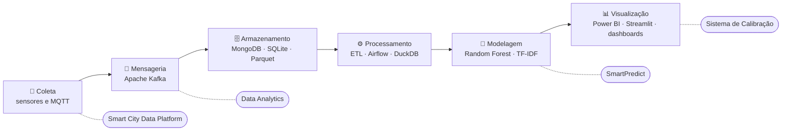
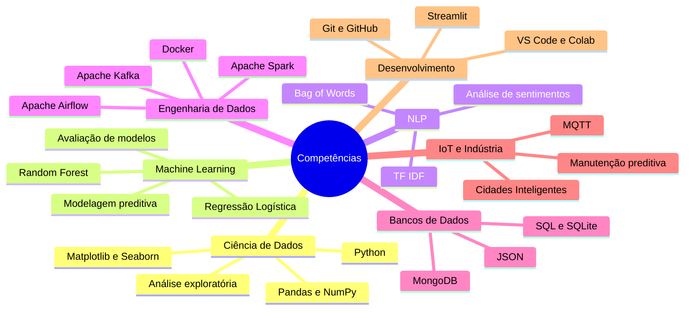

# Engenharia de Controle e Automação | Ciência de Dados e Inteligência Artificial

  

  
  
  
  

  Formação em <b>Engenharia de Controle e Automação | Ciência de Dados e Inteligência Artificial</b>,
  com foco no desenvolvimento de soluções envolvendo <b>Engenharia de Dados</b>.

  <a href="#-sobre">Sobre</a> •
  <a href="#-tecnologias-e-ferramentas">Tecnologias</a> •
  <a href="#-mapa-de-competências">Competências</a> •
  <a href="#-projetos">Projetos</a> •
  <a href="#-áreas-de-interesse">Interesses</a> •
  <a href="#-estatísticas">Estatísticas</a>

---

## 👋 Sobre

Portfólio voltado à **aplicação prática de tecnologias** para análise de dados, modelagem preditiva, processamento
de grandes volumes de informação e automação de processos.

Do dado bruto à decisão: cada etapa aparece em pelo menos um dos projetos abaixo.

## 🧰 Tecnologias e Ferramentas

<b>🐍 Linguagens e Análise de Dados</b>

 

  
  
  
  
  
  

<b>🤖 Machine Learning e Processamento de Linguagem Natural</b>

 

  
  
  
  

- Classificação e modelagem preditiva
- Random Forest e Regressão Logística
- TF-IDF e Bag of Words
- Análise de sentimentos
- Pré-processamento e avaliação de modelos

<b>🗄️ Big Data e Bancos de Dados</b>

 

  
  
  
  
  
  

<b>🔗 Engenharia de Dados e Integração (usadas nos projetos)</b>

 

  
  
  
  
  
  

<b>🛠️ Desenvolvimento e Ferramentas</b>

 

  
  
  
  
  
  
  

## 🧠 Mapa de Competências

## 🚀 Projetos

<table>
  <tr>
    <td width="50%" valign="top">
      <h3>🏭 <a href="https://github.com/jcesarmph-ui/SmartPredict">SmartPredict</a></h3>
      Aplicação de Machine Learning à <b>manutenção preditiva industrial</b>, com análise estatística, preparação de
      dados, treinamento e avaliação de modelos para previsão de falhas (dataset AI4I 2020, Random Forest e
      RandomizedSearchCV).
        
      
      
      
    </td>
    <td width="50%" valign="top">
      <h3>📈 <a href="https://github.com/jcesarmph-ui/DataAnalytics">Data Analytics</a></h3>
      Projeto de Ciência de Dados com foco em processamento e análise de dados, <b>Processamento de Linguagem
      Natural</b>, Machine Learning e tecnologias de Big Data: pipeline de avaliações de produtos com classificação
      de sentimentos e dashboard analítico.
        
      
      
      
      
    </td>
  </tr>
  <tr>
    <td width="50%" valign="top">
      <h3>📏 <a href="https://github.com/jcesarmph-ui/SistemaCalibracao">Sistema de Gestão de Calibração</a></h3>
      Aplicação para <b>gestão de equipamentos, registros de calibração, histórico e controle de prazos</b>, com foco
      na digitalização e melhoria de processos de qualidade.
        
      
      
      
    </td>
    <td width="50%" valign="top">
      <h3>🏙️ <a href="https://github.com/jcesarmph-ui/SmartCityDataPlatform">Smart City Data Platform</a></h3>
      Plataforma de <b>dados urbanos</b> para simulação, integração, processamento e análise de informações de
      cidades inteligentes: sensores simulados via MQTT, Parquet, DuckDB, API FastAPI e dashboard local.
        
      
      
      
      
    </td>
  </tr>
  <tr>
    <td width="50%" valign="top">
      <h3>🍽️ <a href="https://github.com/jcesarmph-ui/PlataformaWeb-AnaliseSensorial">Plataforma Web – Análise Sensorial</a></h3>
      Trabalho de Conclusão de Curso, <b>avaliado com nota máxima</b>, sobre uma plataforma web que automatiza a
      análise sensorial de alimentos — redução de 45,65% no tempo de execução no cenário comparativo do estudo.
        
      
      
      
    </td>
    <td width="50%" valign="top">
      <h3>🔩 <a href="https://github.com/jcesarmph-ui/SistemaDeClassificacao">Sistema de Classificação de Aços</a></h3>
      Aplicação desktop que <b>classifica aços planos</b> — laminados a frio, a quente e zincados — a partir das
      propriedades mecânicas e químicas, indicando o grau conforme as normas ABNT.
        
      
      
      
      
    </td>
  </tr>
  <tr>
    <td colspan="2" valign="top">
      <h3>✍️ <a href="https://github.com/jcesarmph-ui/Textos-Publicados">Artigos de Tecnologia</a></h3>
      Coleção de artigos técnicos e acadêmicos sobre <b>Inteligência Artificial, Internet das Coisas, cidades
      inteligentes</b> e tecnologias emergentes, publicados no blog Crescendo Juntos da Faculdade Engenheiro Salvador Arena.
        
      
      
      
    </td>
  </tr>
</table>

## 🔭 Áreas de Interesse

| | |
|---|---|
| 🧪 Ciência de Dados e Inteligência Artificial | 🏗️ Engenharia de Dados e Big Data |
| 🤖 Machine Learning e Deep Learning | 🧬 Redes Neurais e Processamento de Linguagem Natural |
| 📡 Internet das Coisas (IoT) e MQTT | 🏭 Indústria 4.0 e Cidades Inteligentes |
| ☁️ Computação em Nuvem | ⚙️ Automação e análise de processos |

## 📊 Estatísticas

  
  

---

  <b>Portfólio de projetos práticos voltados ao desenvolvimento contínuo de competências técnicas e à aplicação de
  tecnologias em cenários reais.</b>

