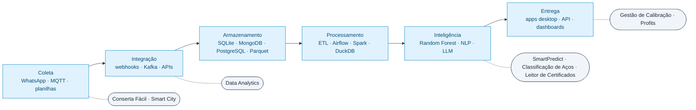
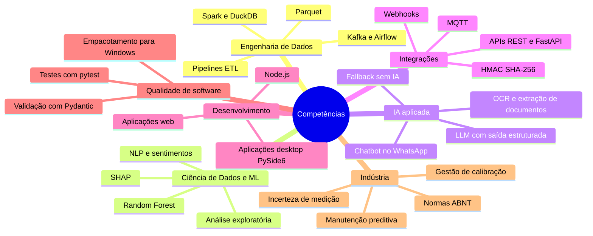

  <b>🌐 Choose your language · Escolha o idioma</b>  
  
  

---

# Engenharia de Controle e Automação | Ciência de Dados e Inteligência Artificial

  
  

  
  
  
  

  Portfólio de soluções que vão do dado bruto à decisão: <b>pipelines de dados</b>, <b>Machine Learning</b>,
  <b>automação de atendimento com IA</b> e <b>aplicações para a indústria</b>, incluindo sistemas em uso
  real em ambiente industrial.

  <b>📄 Currículo</b> 
  
  

  <a href="#-em-números">Em números</a> •
  <a href="#-visão-geral">Visão geral</a> •
  <a href="#-projetos">Projetos</a> •
  <a href="#-tecnologias-e-ferramentas">Tecnologias</a> •
  <a href="#-competências">Competências</a> •
  <a href="#-estatísticas">Estatísticas</a>

---

## 📊 Em números

| Indicador | Valor | Contexto |
|---|---|---|
| Projetos de software publicados | **9** | Dados, Machine Learning, IA aplicada, automação e aplicações desktop e web |
| Sistemas em uso na empresa | **2** | Gestão de Calibração (v1.4.1) e Classificação de Aços Planos (v1.0.0) |
| Testes automatizados | **410** | Suíte pytest do Sistema de Gestão de Calibração |
| Linguagens principais | **3** | Python, JavaScript (Node.js) e SQL |
| Artigos publicados | **3** | IA, IoT e ética, no blog Crescendo Juntos (FESA) |

## 🧭 Visão geral

Cada etapa do ciclo de dados aparece em pelo menos um dos projetos:

## 🚀 Projetos

### 🔎 Visão rápida

| Projeto | Área | Tecnologias principais | Status |
|---|---|---|---|
| [Sistema de Gestão de Calibração](https://github.com/jcesarmph-ui/SistemaCalibracao) | Qualidade industrial | Python, PySide6, SQLite, pytest |  |
| [Classificação de Aços Planos](https://github.com/jcesarmph-ui/SistemaDeClassificacao) | Qualidade industrial | Python, PySide6, scikit-learn, Pydantic |  |
| [Leitor de Certificados com IA](https://github.com/jcesarmph-ui/LeitorCertificadosIA) | IA aplicada e metrologia | scikit-learn, OCR, PySide6 |  |
| [Conserta Fácil](https://github.com/jcesarmph-ui/conserta-facil) | Atendimento e IA | Node.js, WhatsApp Cloud API, OpenAI API |  |
| [Data Analytics](https://github.com/jcesarmph-ui/DataAnalytics) | Engenharia de Dados | Kafka, Airflow, MongoDB, Spark, Power BI |  |
| [SmartPredict](https://github.com/jcesarmph-ui/SmartPredict) | Machine Learning | Scikit-learn, SHAP, Pandas |  |
| [Smart City Data Platform](https://github.com/jcesarmph-ui/SmartCityDataPlatform) | Dados urbanos e IoT | MQTT, DuckDB, Parquet, FastAPI |  |
| [Profits](https://github.com/jcesarmph-ui/Profits) | Finanças pessoais | Python, PySide6, Qt Charts, SQLite |  |
| [Plataforma Web de Análise Sensorial](https://github.com/jcesarmph-ui/PlataformaWeb-AnaliseSensorial) | Aplicação web (TCC) | JavaScript, Supabase, PostgreSQL |  |

<b>🏭 Sistemas em uso na indústria</b>

 
<table>
  <tr>
    <td width="50%" valign="top">
      <h3>📏 <a href="https://github.com/jcesarmph-ui/SistemaCalibracao">Sistema de Gestão de Calibração</a></h3>
      Aplicativo desktop que substituiu uma planilha de cronograma de calibração: cadastro de instrumentos e
      planos, <b>avaliação automática pela incerteza de medição</b>, cronograma mensal, certificados em PDF,
      painel de indicadores e relatórios mensais automáticos, com uso simultâneo em pasta de rede.
        
      
      
      
      
      
    </td>
    <td width="50%" valign="top">
      <h3>🔩 <a href="https://github.com/jcesarmph-ui/SistemaDeClassificacao">Classificação de Aços Planos</a></h3>
      Aplicação desktop que <b>classifica aços planos</b> (laminados a frio, a quente e zincados) a partir das
      propriedades mecânicas e químicas, com motor de regras baseado nas normas ABNT, histórico compartilhado
      e avisos de <b>Machine Learning</b> aprendidos com o próprio histórico.
        
      
      
      
      
      
    </td>
  </tr>
</table>

<b>🤖 Automação e IA aplicada</b>

 
<table>
  <tr>
    <td width="50%" valign="top">
      <h3>💬 <a href="https://github.com/jcesarmph-ui/conserta-facil">Conserta Fácil</a></h3>
      Chatbot de atendimento no <b>WhatsApp</b> para uma assistência técnica fictícia: orçamento, consulta de
      reparo por protocolo, agendamento e encaminhamento para a equipe. A IA interpreta mensagens em texto
      livre com <b>saída estruturada em JSON Schema</b>, e o webhook valida cada evento com HMAC SHA-256.
        
      
      
      
      
    </td>
    <td width="50%" valign="top">
      <h3>💰 <a href="https://github.com/jcesarmph-ui/Profits">Profits</a></h3>
      Aplicativo desktop de <b>gestão de carteira de investimentos</b> que substitui uma planilha: patrimônio por
      classe de ativo, alocação atual e desejada, fechamento mensal com conferências e cotações do dólar e do
      Bitcoin consultadas automaticamente por API.
        
      
      
      
      
    </td>
  </tr>
  <tr>
    <td colspan="2" valign="top">
      <h3>🧾 <a href="https://github.com/jcesarmph-ui/LeitorCertificadosIA">Leitor de Certificados com IA</a></h3>
      Modelo de <b>machine learning</b> que lê certificados de calibração em PDF, digitais ou escaneados
      (<b>OCR</b> local), encontra número do certificado, data, padrões e pontos medidos e confere o
      <b>erro ± U</b> com a tolerância do plano. Treinado com certificados fictícios e melhorado com correções
      reais (campos essenciais de 77% para 96%). Em uso dentro do Sistema de Gestão de Calibração.
        
      
      
      
      
      
    </td>
  </tr>
</table>

<b>🗄️ Engenharia de Dados e Machine Learning</b>

 
<table>
  <tr>
    <td width="50%" valign="top">
      <h3>📈 <a href="https://github.com/jcesarmph-ui/DataAnalytics">Data Analytics</a></h3>
      Pipeline de avaliações de produtos com <b>mensageria, classificação de sentimentos, armazenamento NoSQL,
      orquestração e BI</b>: Kafka transmite os dados, o MongoDB armazena, o Airflow agenda o ETL e o Power BI
      apresenta os indicadores.
        
      
      
      
      
      
      
    </td>
    <td width="50%" valign="top">
      <h3>⚙️ <a href="https://github.com/jcesarmph-ui/SmartPredict">SmartPredict</a></h3>
      <b>Manutenção preditiva industrial</b> com o dataset AI4I 2020 (10.000 registros): ETL, análise
      exploratória, Random Forest, otimização com RandomizedSearchCV, testes de estresse e interpretabilidade
      com <b>SHAP</b>.
        
      
      
      
      
    </td>
  </tr>
  <tr>
    <td colspan="2" valign="top">
      <h3>🏙️ <a href="https://github.com/jcesarmph-ui/SmartCityDataPlatform">Smart City Data Platform</a></h3>
      Plataforma de <b>dados urbanos</b> com sensores simulados de clima, qualidade do ar e mobilidade: publicação
      via MQTT, validação das leituras, cópia analítica em Parquet, consultas com DuckDB, API FastAPI e
      dashboard web local, sem necessidade de hardware físico.
        
      
      
      
      
      
      
    </td>
  </tr>
</table>

<b>🌐 Aplicações web e publicações</b> (clique para expandir)

 
<table>
  <tr>
    <td width="50%" valign="top">
      <h3>🍽️ <a href="https://github.com/jcesarmph-ui/PlataformaWeb-AnaliseSensorial">Plataforma Web de Análise Sensorial</a></h3>
      Trabalho de Conclusão de Curso, <b>avaliado com nota máxima</b>, sobre uma plataforma web que <b>automatiza a
      análise sensorial de alimentos</b>, validada com 26 voluntários, com redução de 45,65% no tempo de execução no cenário comparativo do estudo.
        
      
      
      
      
    </td>
    <td width="50%" valign="top">
      <h3>✍️ <a href="https://github.com/jcesarmph-ui/Textos-Publicados">Artigos de Tecnologia</a></h3>
      Artigos técnicos sobre <b>Inteligência Artificial, Internet das Coisas e cidades inteligentes</b>,
      publicados no blog Crescendo Juntos da Faculdade Engenheiro Salvador Arena.
        
      
      
      
    </td>
  </tr>
</table>

## 🧰 Tecnologias e ferramentas

Somente tecnologias aplicadas em pelo menos um dos projetos acima.

<b>🐍 Linguagens</b>

 

  
  
  
  
  

<b>🔗 Engenharia de Dados e Big Data</b>

 

  
  
  
  
  
  

<b>💾 Bancos de dados</b>

 

  
  
  
  

<b>🧪 Machine Learning e IA</b>

 

  
  
  
  
  
  
  

- Classificação e modelagem preditiva com Random Forest e Regressão Logística
- Processamento de Linguagem Natural: TF-IDF, Bag of Words e análise de sentimentos
- Interpretabilidade de modelos com SHAP
- LLM com saída estruturada (JSON Schema) para extrair dados de texto livre
- Extração de informações de PDFs com OCR local e classificador de palavras

<b>🔌 APIs, integrações e aplicações</b>

 

  
  
  
  
  
  

<b>🛠️ Qualidade de software, empacotamento e ferramentas</b>

 

  
  
  
  
  
  
  
  
  

<b>✨ IA como ferramenta de desenvolvimento</b> (clique para expandir)

 

  
  

Assistentes de IA usados no desenvolvimento, com regras de negócio, arquitetura e revisão de cada etapa
definidas manualmente.

## 🧠 Competências

## 📈 Estatísticas

  
  

---

  <b>Projetos práticos que aplicam dados, IA e automação a problemas reais, da indústria ao atendimento.</b>

  🌐 <a href="https://github.com/jcesarmph-ui">Read this page in English</a>

